# Kinetic

**Universal mouse control for Windows.** Remap every button, build macros, switch profiles per app, shape pointer acceleration and DPI, and see what your mouse is really doing, on any brand of mouse.

[**Download the latest release**](https://github.com/jamimmehdi/kinetic/releases/latest) · [Report a problem](https://github.com/jamimmehdi/kinetic/issues) · [Request support for a mouse](#requesting-support-for-your-mouse)

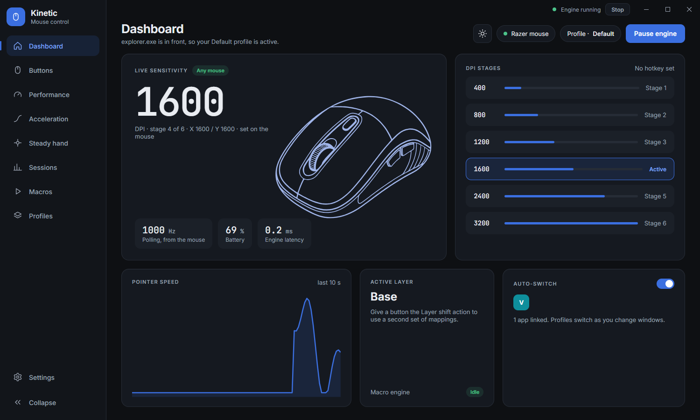

Kinetic is a small open-source alternative to vendor mouse software. It works with any mouse for everything that can be done in software, and talks to the mouse itself (real DPI, polling rate, battery) for brands whose protocol it knows. Razer is supported today, and more are added from user requests.

- [What it does](#what-it-does)
- [Install](#install)
- [First launch](#first-launch)
- [Using Kinetic](#using-kinetic) (every screen)
- [DPI on any mouse: measure and calibrate](#dpi-on-any-mouse-measure-and-calibrate)
- [Games and anti-cheat](#games-and-anti-cheat)
- [What works on which mouse](#what-works-on-which-mouse)
- [Updates](#updates)
- [Requesting support for your mouse](#requesting-support-for-your-mouse)
- [Troubleshooting](#troubleshooting)
- [Build from source](#build-from-source)
- [How it works](#how-it-works)
- [Contributing and releasing](#contributing-and-releasing)
- [License](#license)

## What it does

| Feature | Any mouse | Needs the mouse's protocol |
|---|:---:|:---:|
| Remap any button to a key, shortcut, mouse button, macro, media key, Windows action or app launch | ✅ | |
| Second layer of mappings behind a Shift button | ✅ | |
| Macros with millisecond timing: record or build step by step | ✅ | |
| Profiles that switch automatically when an app comes to the front | ✅ | |
| DPI stages (software scaling), separate X and Y | ✅ | |
| Acceleration curves, rotation, angle snapping, smoothing, 1:1 raw movement | ✅ | |
| Scroll: lines per notch, smooth scrolling, reverse direction | ✅ | |
| Measured polling rate (read only) | ✅ | |
| Find all the buttons on your mouse, including hidden extra ones | ✅ | |
| Measure and calibrate DPI with a ruler, follow the mouse's DPI button | ✅ | |
| Real DPI shown live and set from the app | | ✅ (Razer) |
| Change polling rate from the app | | ✅ (Razer) |
| Battery level | | ✅ (Razer) |

Things no software can do, because the mouse's sensor does not expose them: lift-off distance, motion sync and surface tuning on a basic mouse, or reading a sensor's true DPI on a mouse with no protocol support. Kinetic marks these clearly instead of pretending.

## Install

1. Open the [latest release](https://github.com/jamimmehdi/kinetic/releases/latest).
2. Download `Kinetic-Setup-<version>.exe` and run it.
3. Windows SmartScreen may say *"Windows protected your PC"* because the installer is not code-signed yet. Choose **More info**, then **Run anyway**.
4. Finish the installer and start **Kinetic** from the Start menu.

**Requirements:** Windows 10 or 11, 64-bit. No admin rights are needed to use Kinetic.

Kinetic keeps running in the system tray when you close the window, so your remaps keep working. Quit it from the tray icon.

## First launch

On first launch Kinetic walks you through a short setup so it knows how many buttons your mouse has.

**1. Welcome.** Kinetic finds your mouse and starts its engine. Press **Start**.

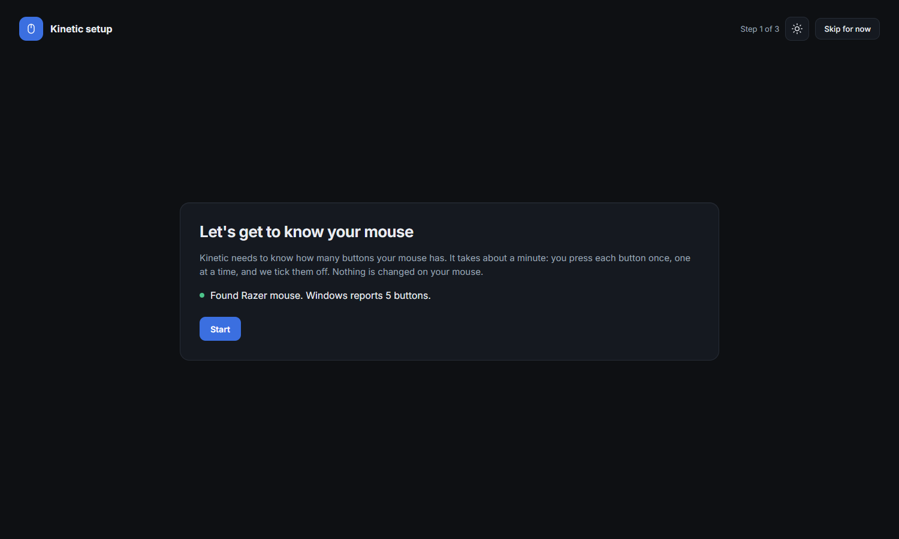

**2. Press every button once.** Press each button on your mouse, one at a time: left, right, wheel click, side buttons, the DPI button and any thumb or top buttons. Each one ticks off when it is detected. The scroll wheel and tilt are not buttons.

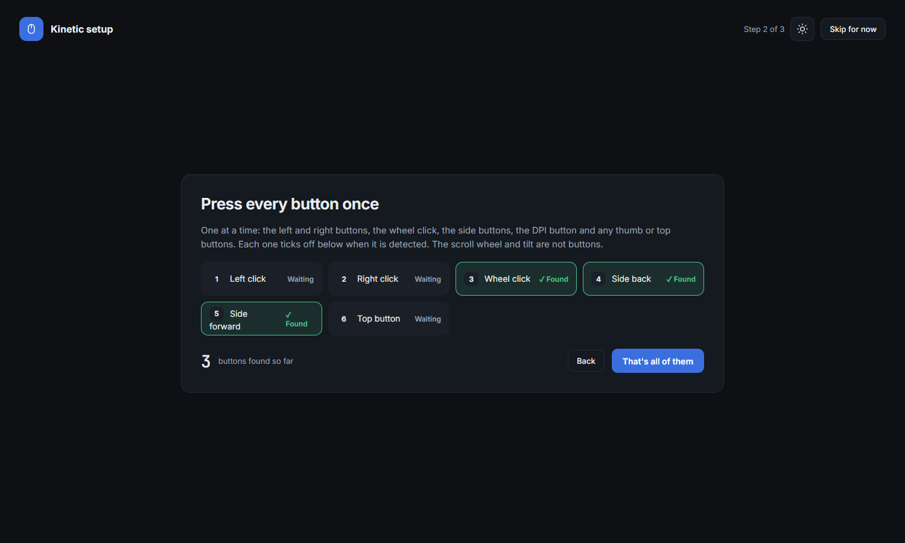

If a button gives a signal Kinetic has not seen before, it asks you to name it ("Thumb grid", for example). It is then added as a new button on your mouse.

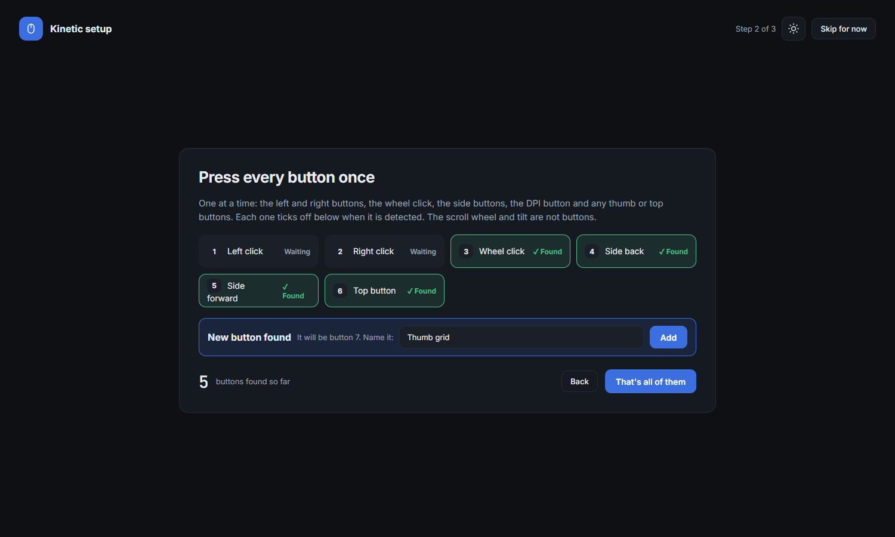

**3. Summary.** You see how many buttons were found. From here you can **Calibrate DPI stages** or **Request support for this mouse** (both explained below), or **Finish**. You can run the guide again any time from Settings.

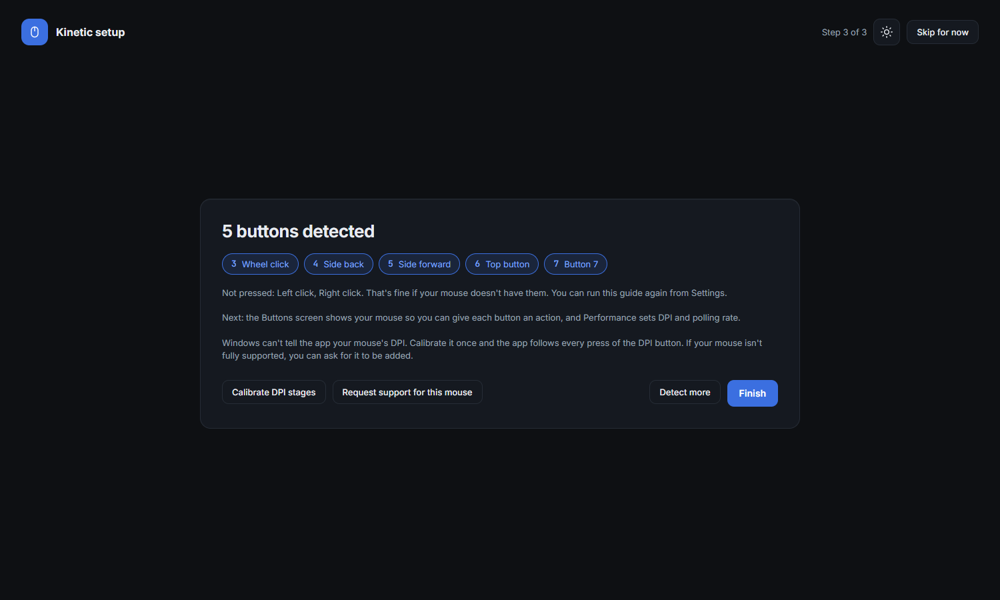

## Using Kinetic

Kinetic has seven screens, reached from the rail on the left. The sun/moon button at the top right switches between the dark and light theme.

### Dashboard

A live view of your mouse: the current DPI and stage, polling rate, battery (where the mouse reports it), engine latency, a 10-second pointer-speed graph, the active layer, and which profile is active and why. **Pause engine** turns off everything Kinetic does to input until you press it again.


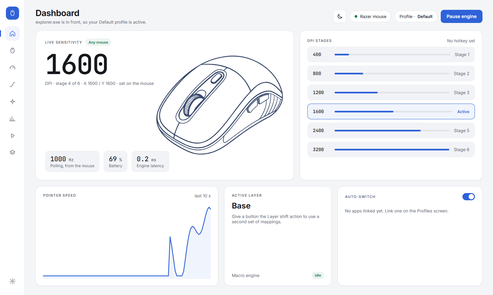

Click a DPI stage on the right to switch to it. The auto-switch card shows how many apps are linked to profiles.

### Buttons

Remap any button. Click a button on the mouse drawing (or in the list) and choose what it does:

| Action | What it does |
|---|---|
| **Keyboard** | Press the shortcut you want when asked (for example `Ctrl+Shift+T`) |
| **Mouse** | Act as another mouse button, or do nothing (disabled) |
| **Macro** | Run one of your macros |
| **Media** | Play/pause, next, previous, volume, mute |
| **Windows** | Copy, paste, cut, undo, select all, task view, show desktop, screenshot, switch app, close window, lock PC, browser back and forward |
| **Launch app** | Start a program you pick |
| **DPI & profile** | Cycle DPI stages, step up or down, jump to a stage, or hold a stage while the button is down |
| **Layer shift** | Turn this button into a Shift button that unlocks the second layer |

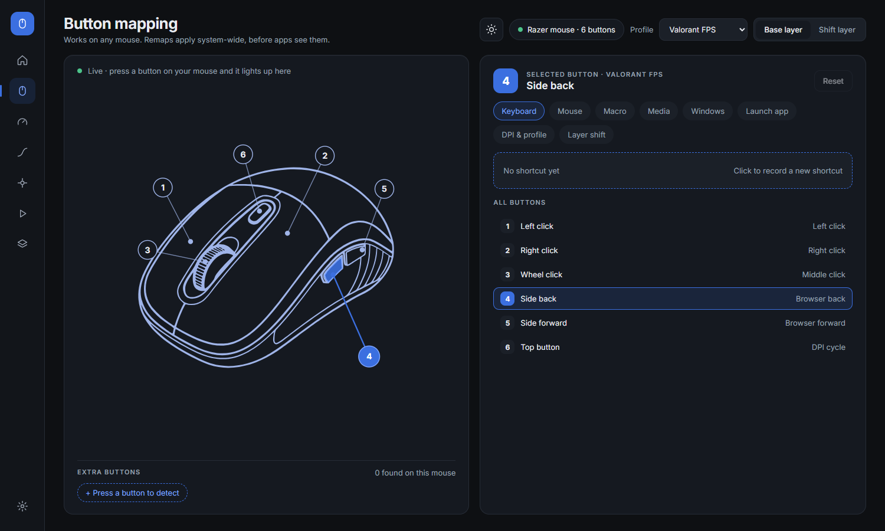

The drawing is built from your mouse: buttons light up live as you press them, and extra buttons found during setup appear in the list. **Press a button to detect** adds more.

Use **Base layer / Shift layer** at the top to edit the second set of mappings, active while a Shift button is held. Each profile has its own mappings.


**Safety rule:** the left mouse button can never be remapped, so you cannot lock yourself out.

### Performance

Sensitivity, polling and pointer feel for the profile you are editing (pick it at the top).

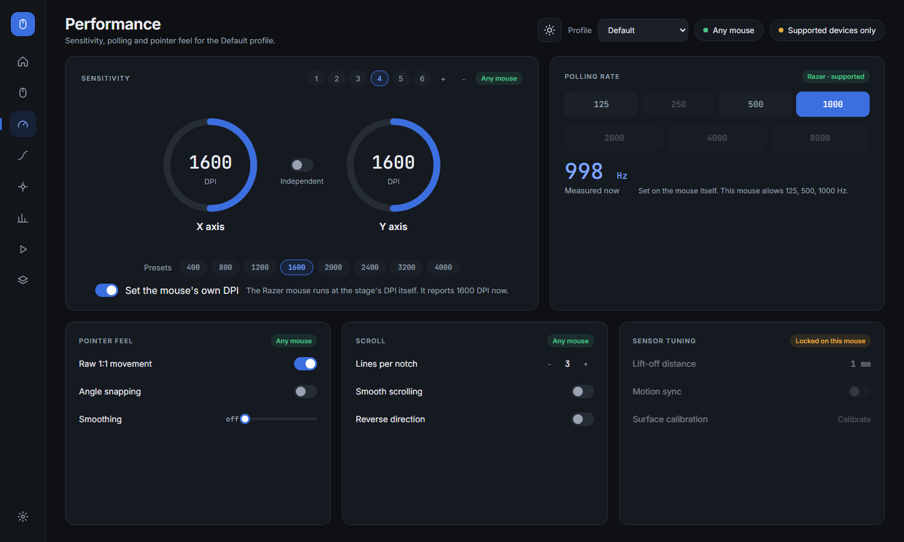

- **Sensitivity:** one dial per axis. Switch on **Independent** to set X and Y separately. The numbered chips are your DPI stages (**＋** adds one, **－** removes the selected one, up to 8). Stages are always kept in ascending order. Presets set the selected stage to 400, 800, 1200, 1600, 2000, 2400, 3200 or 4000.
- **Set the mouse's own DPI** (mice Kinetic can talk to): the mouse itself runs at the stage's DPI and reports the real value back. If the mouse's own DPI button is pressed, Kinetic follows it.
- **Polling rate:** on supported mice, pick 125, 500 or 1000 Hz. On other mice it shows the rate it measures, read only.
- **Pointer feel:** raw 1:1 movement, angle snapping, smoothing.
- **Scroll:** lines per notch, smooth scrolling, reverse direction.
- **Sensor tuning:** lift-off distance, motion sync and surface calibration are shown locked because they need a mouse-specific protocol.

For a mouse Kinetic cannot read directly, the sensitivity card asks for the mouse's own DPI instead. If you do not know it, press **Measure it** (see below).

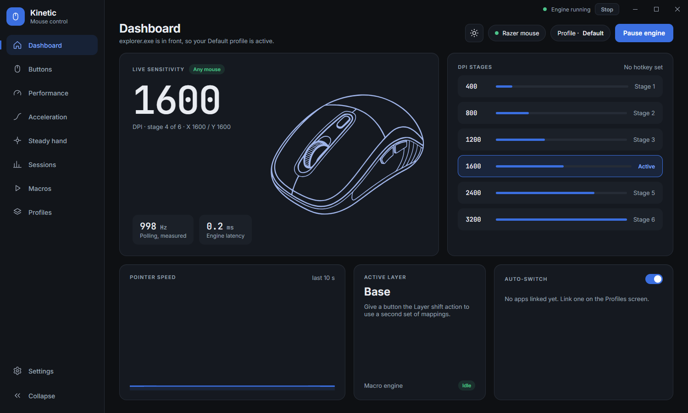

### Acceleration

Choose how hand speed turns into pointer speed. The graph is the curve; the numbers show the live multiplier and your current speed.

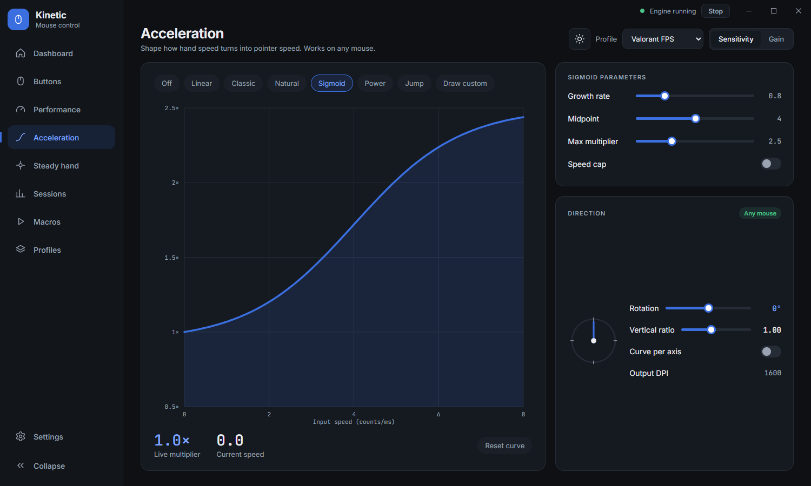

- **Modes:** Off, Linear, Classic, Natural, Sigmoid, Power, Jump, or **Draw custom** (drag points on the graph).
- **Sensitivity / Gain** at the top right picks whether the curve scales sensitivity or gain.
- **Parameters** (shown for the mode you choose): growth rate, midpoint, maximum multiplier, and an optional speed cap.
- **Direction:** rotation, vertical ratio, and **curve per axis** for separate horizontal and vertical curves.

The curve math is the same in the interface and the engine, and a test checks that they agree.

### Macros

Record or build sequences with millisecond timing, then give them to any button.

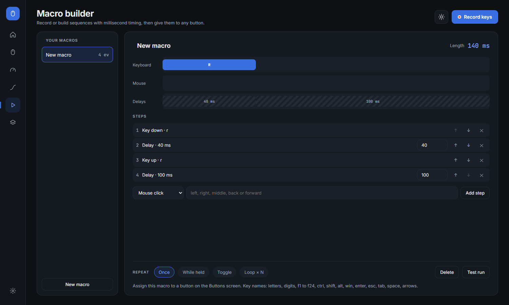

1. **New macro** (bottom left), then type a name for it.
2. Either press **Record keys** and do the keystrokes, or add steps by hand: key tap, key down, key up, mouse click, mouse down, mouse up, delay (ms), or move pointer (`dx,dy`).
3. The timeline shows keyboard, mouse and delay steps. Reorder with the arrows, edit delays inline, delete with ✕.
4. Choose how it repeats: **Once**, **While held** (repeats while the button is down), **Toggle** (starts and stops on press) or **Loop × N**.
5. **Test run** plays it now. Assign it on the Buttons screen under **Macro**.

### Profiles

A profile bundles button mappings, DPI stages, acceleration, scroll and pointer settings. The **Default** profile applies everywhere. Link another profile to an app and it switches on automatically when that app comes to the front, then switches back.

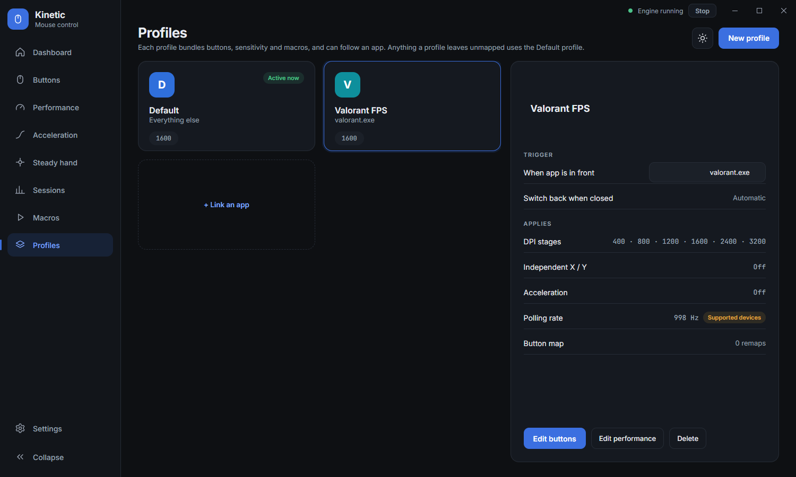

1. **New profile** (or **+ Link an app**), give it a name.
2. Set **When app is in front** to an executable name such as `valorant.exe`. Type it, or pick from the list of running apps.
3. **Edit buttons** and **Edit performance** jump to those screens for this profile.

Anything a profile leaves unmapped falls back to the Default profile. Settings changes always apply to the profile selected at the top of the screen, not to whichever app is in front.

### Settings

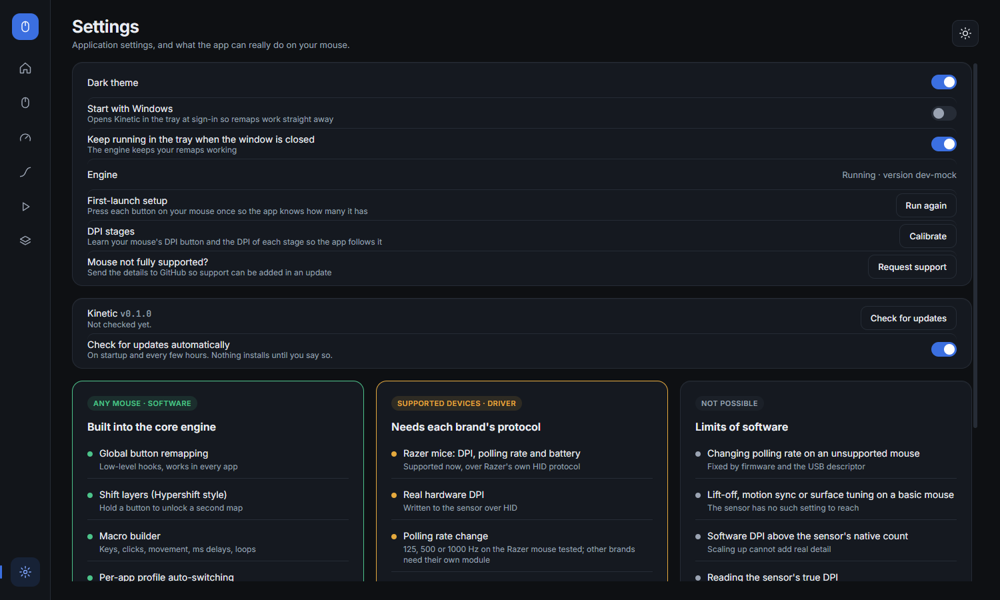

- **Dark theme**, **Start with Windows** (opens in the tray at sign-in), **Keep running in the tray** when the window is closed.
- **First-launch setup:** run the button guide again.
- **DPI stages:** calibrate your mouse's DPI button.
- **Request support:** send your mouse's details to GitHub.
- **Updates:** current version, **Check for updates**, and automatic checks. Nothing installs until you say so.
- The three columns summarise what works on any mouse, what needs a brand's protocol, and what is not possible.

## DPI on any mouse: measure and calibrate

Windows never tells an app a mouse's DPI. Kinetic reads it directly from mice it has a protocol for (Razer). For every other mouse there are two tools that need only a ruler.

### Measure the DPI

On **Performance**, next to *Your mouse's own DPI is set to*, press **Measure it**. Pick 5, 10 or 20 cm, press **Start**, move the mouse in a straight line along that distance on a ruler, and press **Done**. Kinetic counts what the sensor sent and works out the DPI.

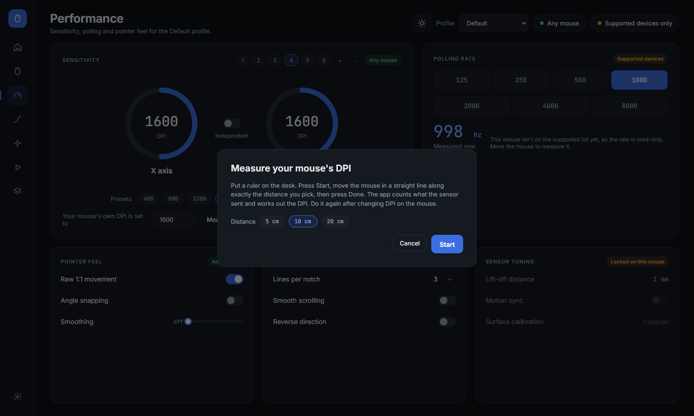
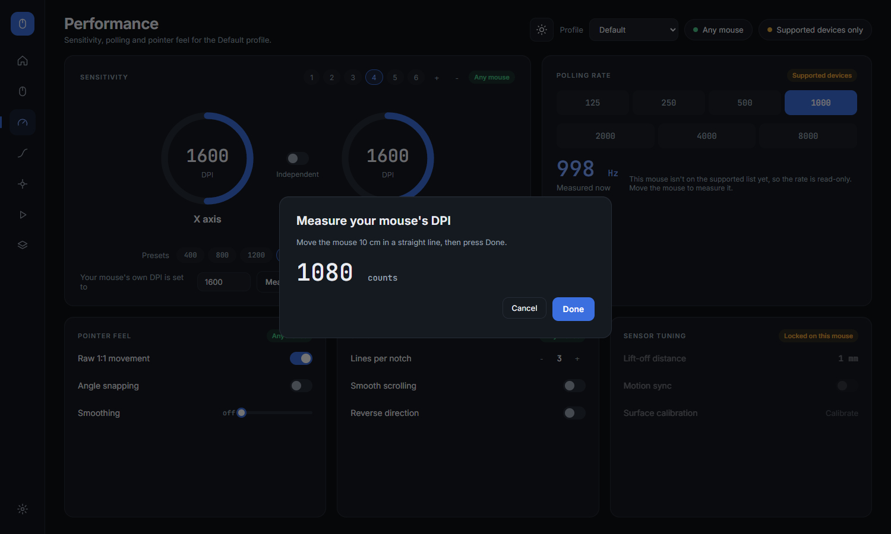
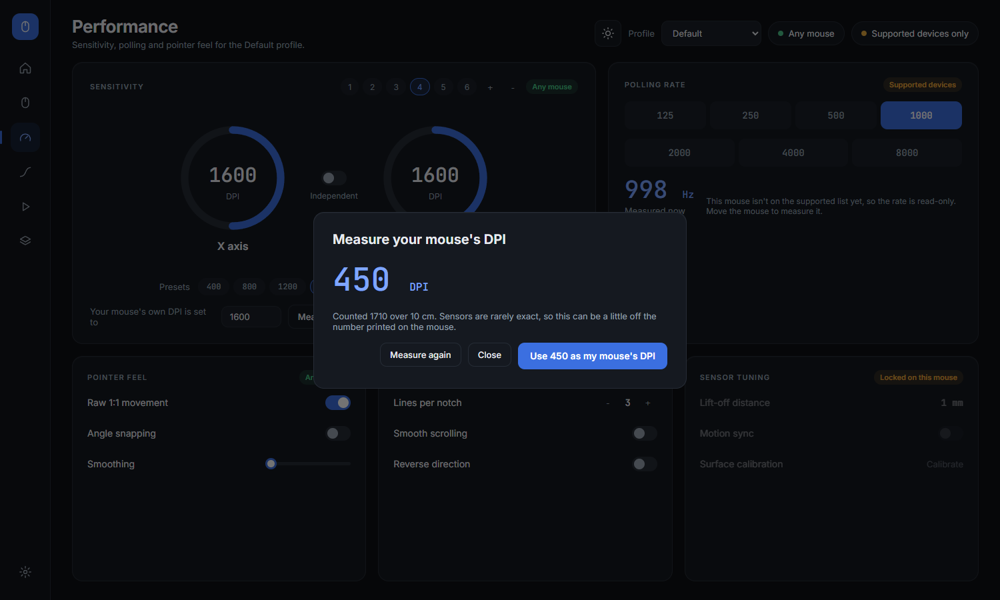

Press **Use N as my mouse's DPI** to save it. Sensors are rarely exact, so expect a result close to, not identical to, the printed number.

### Calibrate the DPI button

Settings → **Calibrate** teaches Kinetic your mouse's DPI button and the DPI of each stage, so afterwards every press of that button shows the right DPI on the Dashboard.

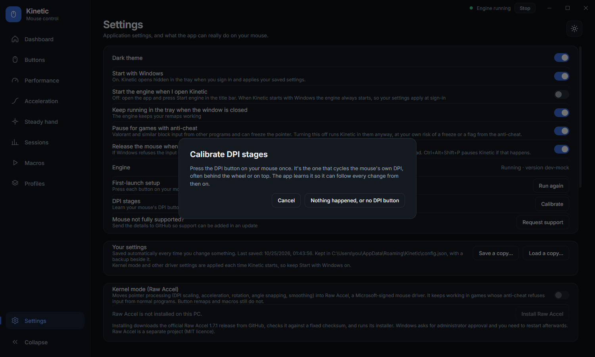

1. Press the mouse's **DPI button** once. Kinetic learns it. If nothing happens, choose *Nothing happened, or no DPI button* to measure the current DPI only.
2. Move the mouse 10 cm along a ruler and press **Done**. That is stage 1.
3. Press the DPI button, move 10 cm again. Repeat until the DPI wraps back to the first value. Kinetic notices the repeat and finishes.

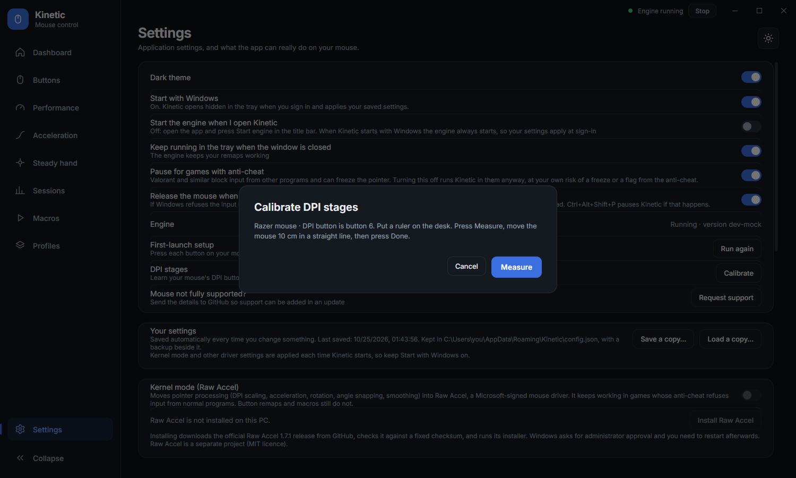

The stage is remembered per mouse model. Kinetic cannot ask the mouse which stage it is on, so after a restart it shows the last stage it knew. Press the DPI button, or calibrate again, if it is out of step.

## Games and anti-cheat

Games with kernel-level anti-cheat (Riot Vanguard, Easy Anti-Cheat, BattlEye and similar) block input that other programs inject, which can freeze the pointer. So Kinetic **steps aside completely** while a known protected game is in front: your remaps, DPI stages and acceleration are off, and the Dashboard shows **Paused for a game**. The mouse behaves as if Kinetic were not running.

Built-in list: Valorant, League of Legends, Fortnite, Apex Legends, Elden Ring, Destiny 2, Battlefield, Call of Duty, Rainbow Six Siege, PUBG, Escape from Tarkov, Fall Guys, THE FINALS, Marvel Rivals, Deadlock and DayZ. A fallback also releases the mouse if Kinetic ever sees its own injected input being dropped, and tries again when you switch windows.

Anti-cheat can flag input tools that merely run. If you play competitively, the safest choice is to quit Kinetic from the tray before launching the game.

## What works on which mouse

- **Any mouse:** everything in the "Any mouse" column above. It uses Windows' own mouse input, so it needs no driver.
- **Razer mice:** real DPI, polling rate (125, 500, 1000 Hz) and battery, read and set over the mouse's own HID protocol. Developed and tested on a single model, so other Razer models may behave differently. Please [report them](#requesting-support-for-your-mouse).
- **Other brands:** no live DPI or polling control yet. Use [Measure and Calibrate](#dpi-on-any-mouse-measure-and-calibrate), and request support so a protocol can be added.

Where Kinetic cannot do something on your mouse, the control is shown locked and labelled rather than left looking usable.

## Updates

Installed copies of Kinetic check this repository for new releases a little after start and every few hours (turn this off in Settings). When one is found, Settings → Updates shows **Download**, then **Restart and update**. Nothing installs without your click.

## Requesting support for your mouse

If your mouse is not fully supported, Kinetic can send the details a maintainer needs to add it.

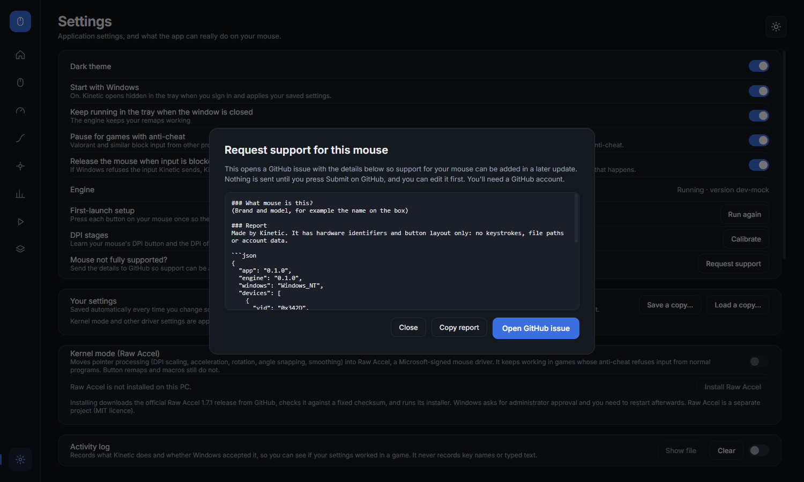

1. Settings → **Request support** (or at the end of the setup guide).
2. Review the report. It contains hardware identifiers (vendor and product IDs), the mouse's HID layout, the signals of any extra buttons you taught it, your measured DPI stages, and the app, engine and Windows versions. **No keystrokes, file paths or account data.**
3. **Open GitHub issue** opens a prefilled issue in your browser. You can edit it, and nothing is sent until you press **Submit** on GitHub. You need a GitHub account. Long reports are copied to your clipboard for you to paste in.
4. Add the brand and model of your mouse. The maintainer uses the report to add support, and it ships in an update.

## Troubleshooting

| Problem | What to do |
|---|---|
| The pointer freezes in a game | Update to 0.1.1 or later. If it still happens, quit Kinetic from the tray before playing and [open an issue](https://github.com/jamimmehdi/kinetic/issues) with the game name |
| *"Engine not running"* | Wait a few seconds, it restarts itself. If it stays, quit Kinetic from the tray and start it again |
| A button does nothing when remapped | Check you are editing the profile that is active, and that the engine is not paused. The left button cannot be remapped |
| Remaps do not work in a game | Expected for protected games, see [Games and anti-cheat](#games-and-anti-cheat) |
| An extra button is not detected | Settings → **Run again** under First-launch setup, or Buttons → **Press a button to detect** |
| Wrong DPI shown on a non-Razer mouse | Press the DPI button, or Settings → **Calibrate** again |
| SmartScreen warns on install | The installer is unsigned. Choose **More info → Run anyway** |

Your settings live in `%APPDATA%\Kinetic\config.json`. Pointer settings Kinetic changes (such as scroll lines) are restored when it quits, and on the next start after a crash.

## Build from source

**Requirements:** Windows 10/11, [Rust](https://rustup.rs) (stable, MSVC toolchain), [Node.js](https://nodejs.org) 20 or newer.

Run in development (two terminals):

```
cd engine
cargo run
```

```
cd app
npm install
npm run dev
```

Open `http://localhost:5173` in a plain browser to work on the interface without the engine. A mock engine answers: keys `1` to `7` act as mouse buttons and holding `M` fakes movement.

Package the installer:

```
cd engine
cargo build --release
cd ../app
npm run dist
```

`npm run pack` makes an unpacked app in `app/release/win-unpacked` instead. The app starts the bundled engine itself.

Run the tests:

```
cd engine
cargo test
cd ../app
npm run typecheck
npm run test:parity
```

`cargo test` runs the engine's unit tests. `test:parity` checks that the interface's acceleration curves match the engine's. `tests/e2e` drives a real engine with injected input; see [tests/e2e/README.md](tests/e2e/README.md).

To regenerate the screenshots in this README, run `npx vite --port 5173 --host 127.0.0.1` in `app`, then `electron scripts/shoot-docs.js` with `SHOOT_OUT` set to `docs/screenshots`.

## How it works

Two programs that talk over a named pipe (`\\.\pipe\kinetic-engine`, one JSON object per line):

- **`engine/`** (Rust): everything time-critical lives here so a busy or closed interface can never make the mouse stutter. It reads devices with Raw Input, hooks mouse input with a low-level hook to remap buttons and the wheel, moves the pointer with `SendInput` for DPI, acceleration and smoothing, runs macros, watches the foreground app for profiles, and talks to Razer mice over HID.
- **`app/`** (Electron, React, TypeScript): the interface, tray icon, start-with-Windows, and installer. It starts the engine and reconnects if it stops.

Safety rules built in:

- The left button can never be remapped.
- Movement is only swallowed after the first raw movement has been seen, so a failure cannot leave you with a dead pointer.
- Pointer settings Windows owns are changed for the session only and restored on exit.
- Input the engine injects itself is ignored by its own hook, so a remap can never trigger itself.
- The engine steps aside for protected games and if its input is blocked.

## Contributing and releasing

Issues and pull requests are welcome. Mouse support requests are the most useful contribution: use the in-app button, or the [mouse support issue template](.github/ISSUE_TEMPLATE/mouse-support.md).

To publish a release:

1. Raise `version` in `app/package.json` and `engine/Cargo.toml`.
2. `cd engine && cargo build --release`, then `cd ../app && npm run dist`.
3. Create a GitHub release for the tag and upload `Kinetic-Setup-<version>.exe`, its `.blockmap` and `latest.yml` from `app/release/`. Installed copies find it through the in-app updater.

The repository an installed app reads updates from is set under `kinetic.updates` in `app/package.json`, and where the support button opens issues under `kinetic.repo`.

## License

MIT. See [LICENSE](LICENSE).
