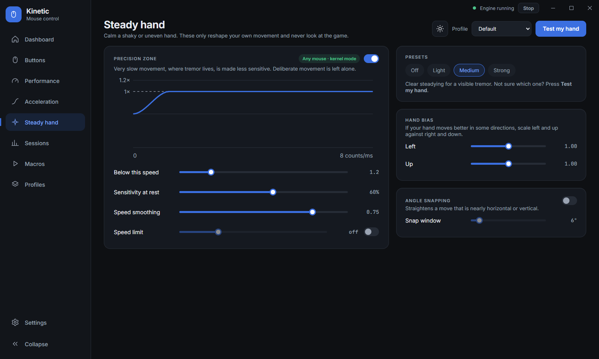
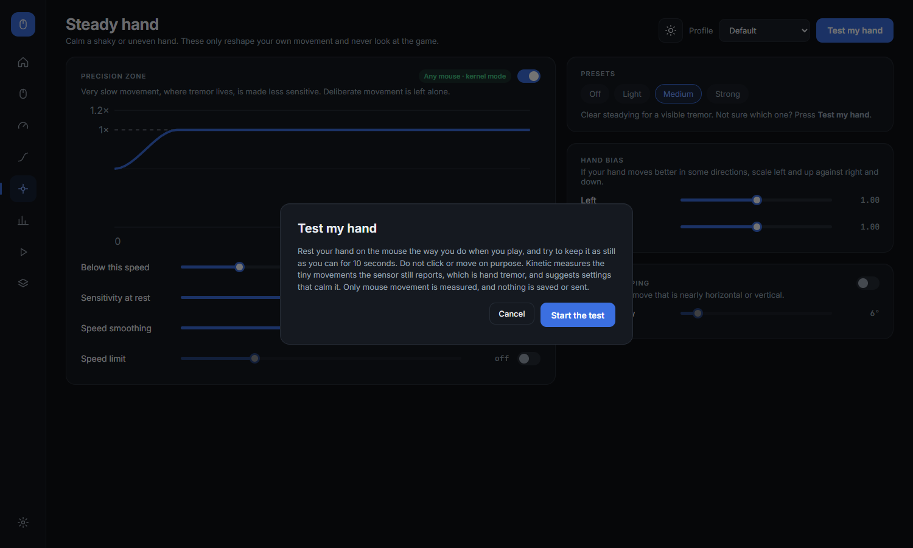
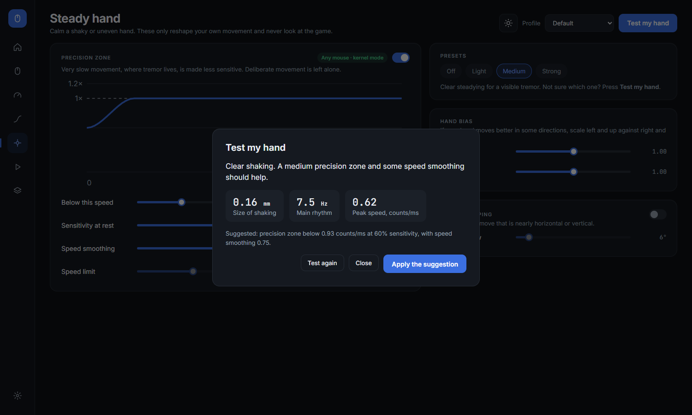
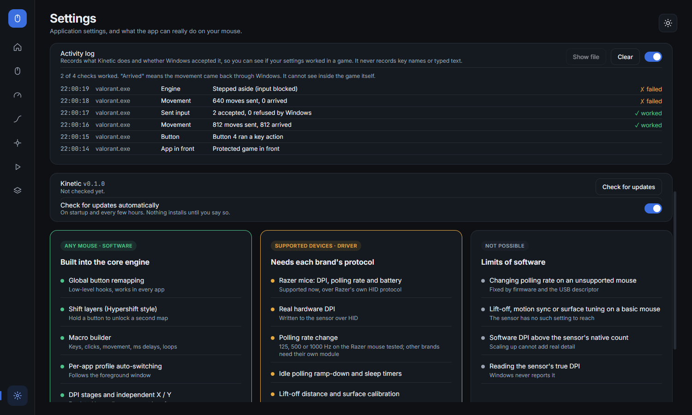
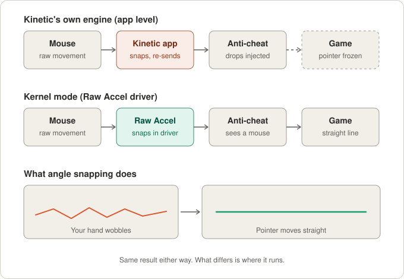
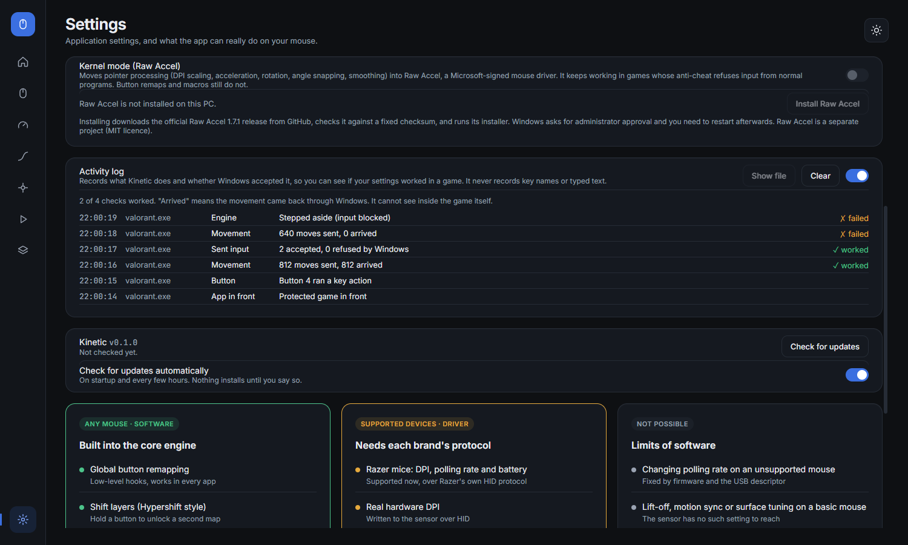

# Kinetic

**Universal mouse control for Windows.** Remap every button, build macros, switch profiles per app, shape pointer acceleration and DPI, and see what your mouse is really doing, on any brand of mouse. In games with kernel-level anti-cheat, an optional **kernel mode** hands the movement work to the Raw Accel driver so it keeps working there.

[**Download the latest release**](https://github.com/jamimmehdi/kinetic/releases/latest) · [Report a problem](https://github.com/jamimmehdi/kinetic/issues) · [Request support for a mouse](#requesting-support-for-your-mouse)


Kinetic is a small open-source alternative to vendor mouse software. It works with any mouse for everything that can be done in software, and talks to the mouse itself (real DPI, polling rate, battery) for brands whose protocol it knows. Razer is supported today, and more are added from user requests.

- [What it does](#what-it-does)
- [Install](#install)
- [First launch](#first-launch)
- [Using Kinetic](#using-kinetic) (every screen)
- [DPI on any mouse: measure and calibrate](#dpi-on-any-mouse-measure-and-calibrate)
- [Games and anti-cheat](#games-and-anti-cheat)
- [Kernel mode (Raw Accel) in detail](#kernel-mode-raw-accel-in-detail)
- [What works on which mouse](#what-works-on-which-mouse)
- [Updates](#updates)
- [Requesting support for your mouse](#requesting-support-for-your-mouse)
- [Troubleshooting](#troubleshooting)
- [Where Kinetic keeps its files](#where-kinetic-keeps-its-files)
- [Build from source](#build-from-source)
- [How it works](#how-it-works)
- [Contributing and releasing](#contributing-and-releasing)
- [Credits and licence](#credits-and-licence)

## What it does

| Feature | Any mouse | Needs the mouse's protocol |
|---|:---:|:---:|
| Remap any button to a key, shortcut, mouse button, macro, media key, Windows action or app launch | ✅ | |
| Second layer of mappings behind a Shift button | ✅ | |
| Macros with millisecond timing: record or build step by step | ✅ | |
| Profiles that switch automatically when an app comes to the front | ✅ | |
| DPI stages (software scaling), separate X and Y | ✅ | |
| Acceleration curves, rotation, angle snapping, smoothing, 1:1 raw movement | ✅ | |
| Steady-hand settings for a shaky or uneven hand: precision zone, speed limit, hand bias, adjustable snapping, and a hold-still test that suggests them | ✅ | |
| Scroll: lines per notch, smooth scrolling, reverse direction | ✅ | |
| Measured polling rate (read only) | ✅ | |
| Find all the buttons on your mouse, including hidden extra ones | ✅ | |
| Measure and calibrate DPI with a ruler, follow the mouse's DPI button | ✅ | |
| Real DPI shown live and set from the app | | ✅ (Razer) |
| Change polling rate from the app | | ✅ (Razer) |
| Battery level | | ✅ (Razer) |

Things no software can do, because the mouse's sensor does not expose them: lift-off distance, motion sync and surface tuning on a basic mouse, or reading a sensor's true DPI on a mouse with no protocol support. Kinetic marks these clearly instead of pretending.

**What works in games with kernel-level anti-cheat** (Riot Vanguard, Easy Anti-Cheat, BattlEye and similar) depends on where the work runs:

| Feature | Kinetic's own engine | Kernel mode (Raw Accel) | Stored on the mouse |
|---|:---:|:---:|:---:|
| DPI scaling, acceleration, rotation, angle snapping, smoothing, steady-hand settings | ❌ blocked | ✅ | |
| Button remaps, macros, Shift layer | ❌ blocked | ❌ not covered | |
| DPI stages, polling rate, simple button remaps | | | ✅ (needs the brand's protocol) |

Details are in [Games and anti-cheat](#games-and-anti-cheat) and [Kernel mode in detail](#kernel-mode-raw-accel-in-detail).

## Install

1. Open the [latest release](https://github.com/jamimmehdi/kinetic/releases/latest).
2. Download `Kinetic-Setup-<version>.exe` and run it.
3. Windows SmartScreen may say *"Windows protected your PC"* because the installer is not code-signed yet. Choose **More info**, then **Run anyway**.
4. Finish the installer and start **Kinetic** from the Start menu.

**Requirements:** Windows 10 or 11, 64-bit. No admin rights are needed to use Kinetic. The only thing that asks for administrator approval is the optional [Raw Accel driver](#kernel-mode-raw-accel-in-detail) install.

Kinetic keeps running in the system tray when you close the window, so your remaps keep working. Quit it from the tray icon.

## First launch

On first launch Kinetic walks you through a short setup so it knows how many buttons your mouse has.

**1. Welcome.** Kinetic finds your mouse and starts its engine. Press **Start**.


**2. Press every button once.** Press each button on your mouse, one at a time: left, right, wheel click, side buttons, the DPI button and any thumb or top buttons. Each one ticks off when it is detected. The scroll wheel and tilt are not buttons.


If a button gives a signal Kinetic has not seen before, it asks you to name it ("Thumb grid", for example). It is then added as a new button on your mouse.


**3. Summary.** You see how many buttons were found. From here you can **Calibrate DPI stages** or **Request support for this mouse** (both explained below), or **Finish**. You can run the guide again any time from Settings.


## Using Kinetic

Kinetic has eight screens, reached from the rail on the left. The sun/moon button at the top right switches between the dark and light theme.

### Dashboard

A live view of your mouse: the current DPI and stage, polling rate, battery (where the mouse reports it), engine latency, a 10-second pointer-speed graph, the active layer, and which profile is active and why.


- Click a DPI stage on the right to switch to it. The auto-switch card shows how many apps are linked to profiles.
- **Pause engine** turns off everything Kinetic's engine does to input until you press it again. In kernel mode it also sets the driver back to neutral.
- The button changes to **Paused for a game** when a protected game is in front, or **Paused: input blocked** when Windows is refusing the input Kinetic sends. Both clear on their own (see [Games and anti-cheat](#games-and-anti-cheat)).

### Buttons

Remap any button. Click a button on the mouse drawing (or in the list) and choose what it does:

| Action | What it does |
|---|---|
| **Keyboard** | Press the shortcut you want when asked (for example `Ctrl+Shift+T`) |
| **Mouse** | Act as another mouse button, or do nothing (disabled) |
| **Macro** | Run one of your macros |
| **Media** | Play/pause, next, previous, volume, mute |
| **Windows** | Copy, paste, cut, undo, select all, task view, show desktop, screenshot, switch app, close window, lock PC, browser back and forward |
| **Launch app** | Start a program you pick |
| **DPI & profile** | Cycle DPI stages, step up or down, jump to a stage, or hold a stage while the button is down |
| **Layer shift** | Turn this button into a Shift button that unlocks the second layer |


The drawing is built from your mouse: buttons light up live as you press them, and extra buttons found during setup appear in the list. **Press a button to detect** adds more.

Use **Base layer / Shift layer** at the top to edit the second set of mappings, active while a Shift button is held. Each profile has its own mappings.


**Safety rule:** the left mouse button can never be remapped, so you cannot lock yourself out.

Button remaps work by catching the button press and sending a different input, which anti-cheat games refuse. They are therefore off in those games, in kernel mode too.

### Performance

Sensitivity, polling and pointer feel for the profile you are editing (pick it at the top).


- **Sensitivity:** one dial per axis. Switch on **Independent** to set X and Y separately. The numbered chips are your DPI stages (**＋** adds one, **－** removes the selected one, up to 8). Stages are always kept in ascending order. Presets set the selected stage to 400, 800, 1200, 1600, 2000, 2400, 3200 or 4000.
- **Set the mouse's own DPI** (mice Kinetic can talk to): the mouse itself runs at the stage's DPI and reports the real value back. If the mouse's own DPI button is pressed, Kinetic follows it.
- **Polling rate:** on supported mice, pick 125, 500 or 1000 Hz. On other mice it shows the rate it measures, read only.
- **Pointer feel:** raw 1:1 movement (turns off Windows' own pointer acceleration while Kinetic processes movement), angle snapping, and smoothing. Smoothing goes up to 0.98, and the label beside the slider shows how long it takes to catch up halfway in milliseconds (about 3 ms at 0.8, 14 ms at 0.95, 34 ms at 0.98 on a 1000 Hz mouse). More smoothing means more delay between your hand and the pointer.
- **Scroll:** lines per notch, smooth scrolling, reverse direction.
- **Sensor tuning:** lift-off distance, motion sync and surface calibration are shown locked because they need a mouse-specific protocol.

For a mouse Kinetic cannot read directly, the sensitivity card asks for the mouse's own DPI instead. If you do not know it, press **Measure it** (see below).


### Acceleration

Choose how hand speed turns into pointer speed. The graph is the curve; the numbers show the live multiplier and your current speed.


- **Modes:** Off, Linear, Classic, Natural, Sigmoid, Power, Jump, or **Draw custom** (drag points on the graph).
- **Sensitivity / Gain** at the top right picks whether the curve scales sensitivity or gain.
- **Parameters** (shown for the mode you choose): growth rate, midpoint, maximum multiplier, and an optional speed cap.
- **Direction:** rotation, vertical ratio, and **curve per axis** for separate horizontal and vertical curves.

The curve math is the same in the interface and the engine, and a test checks that they agree. In kernel mode the finished curve is sent to the driver as a table of points, so it keeps the same shape.

### Steady hand

Settings that calm a shaky or uneven hand. They only reshape the movement your own mouse reports, using fixed formulas, and never look at the game. They apply to the profile selected at the top, work on any mouse, and (in [kernel mode](#kernel-mode-raw-accel-in-detail)) in games with anti-cheat.



- **Precision zone.** Very slow movement, where tremor lives, is made less sensitive. Below the chosen speed, sensitivity eases down to a set share of normal at a standstill, and back to normal at that speed. The graph shows the resulting curve. Deliberate movement above the speed is left alone.
- **Speed smoothing.** Smooths the speed that acceleration uses, so a jittery speed does not make the curve jitter. It does not delay the pointer, unlike the pointer smoothing on Performance.
- **Speed limit.** Caps how fast the pointer can move per millisecond, so a sudden jerk cannot throw the pointer. Movement below the limit is unchanged. It works with or without an acceleration curve.
- **Hand bias.** Scales left and up against right and down, for hands that move better in some directions.
- **Angle snapping.** Straightens a move that is nearly horizontal or vertical. The **snap window** sets how many degrees from straight still counts (1° to 45°).
- **Presets.** **Off**, **Light**, **Medium** and **Strong** fill in the precision zone and speed smoothing for you. Pick the one that matches, or use the test below.

#### Test my hand

Press **Test my hand** to have Kinetic measure your tremor instead of guessing.




1. Rest your hand on the mouse the way you do when you play and keep it as still as you can for 10 seconds. Do not click or move on purpose.
2. Kinetic records the tiny movements the sensor still reports. It removes slow drift (a hand that creeps is not trembling) and measures what is left: how big the shaking is in millimetres at the sensor, its main rhythm in hertz, and how fast it moves.
3. It then sorts the result into **none**, **light**, **medium** or **strong** and suggests a precision zone and speed smoothing to match. **Apply the suggestion** copies them into your profile. You can still change every value by hand.

Only mouse movement is measured. Nothing is saved or sent, and the recording stops when you close the dialog. The suggestion deliberately leaves pointer smoothing alone, because delay costs more aim than it gains. The measurements are only as good as the test, so repeat it if the result looks off.

### Macros

Record or build sequences with millisecond timing, then give them to any button.


1. **New macro** (bottom left), then type a name for it.
2. Either press **Record keys** and do the keystrokes, or add steps by hand: key tap, key down, key up, mouse click, mouse down, mouse up, delay (ms), or move pointer (`dx,dy`).
3. The timeline shows keyboard, mouse and delay steps. Reorder with the arrows, edit delays inline, delete with ✕.
4. Choose how it repeats: **Once**, **While held** (repeats while the button is down), **Toggle** (starts and stops on press) or **Loop × N**.
5. **Test run** plays it now. Assign it on the Buttons screen under **Macro**.

### Profiles

A profile bundles button mappings, DPI stages, acceleration, scroll and pointer settings. The **Default** profile applies everywhere. Link another profile to an app and it switches on automatically when that app comes to the front, then switches back.


1. **New profile** (or **+ Link an app**), give it a name.
2. Set **When app is in front** to an executable name such as `valorant.exe`. Type it, or pick from the list of running apps.
3. **Edit buttons** and **Edit performance** jump to those screens for this profile.

Anything a profile leaves unmapped falls back to the Default profile. Settings changes always apply to the profile selected at the top of the screen, not to whichever app is in front.

### Settings


| Setting | What it does |
|---|---|
| **Dark theme** | Switches between the dark and light theme |
| **Start with Windows** | Opens Kinetic hidden in the tray at sign-in, so your remaps and driver settings are applied straight away. The row reads the start-up entry back from Windows and says if it is missing, points at the wrong program or has been switched off under Settings → Apps → Startup, with a **Repair** or **Open Windows settings** button |
| **Your settings** | Settings are saved automatically every time you change something (the row shows when, and where, with a backup beside the file). **Save a copy…** writes them to a file you choose and **Load a copy…** restores one |
| **Keep running in the tray** | Closing the window keeps the engine and your remaps running |
| **Pause for games with anti-cheat** | On by default. Kinetic's engine steps aside while a protected game is in front |
| **Release the mouse when input is blocked** | On by default. If Windows refuses the input Kinetic sends, the engine steps aside so the pointer keeps working |
| **First-launch setup** | Runs the button guide again |
| **DPI stages** | **Calibrate** your mouse's DPI button and the DPI of each stage |
| **Request support** | Sends your mouse's details to GitHub |
| **Kernel mode (Raw Accel)** | Installs the Raw Accel driver and hands it the movement work (see [below](#kernel-mode-raw-accel-in-detail)) |
| **Activity log** | Off by default. Records what Kinetic did and whether Windows accepted it |
| **Updates** | Current version, **Check for updates**, and automatic checks. Nothing installs until you say so |

The three columns at the bottom summarise what works on any mouse, what needs a brand's protocol, and what is not possible.

## DPI on any mouse: measure and calibrate

Windows never tells an app a mouse's DPI. Kinetic reads it directly from mice it has a protocol for (Razer). For every other mouse there are two tools that need only a ruler.

### Measure the DPI

On **Performance**, next to *Your mouse's own DPI is set to*, press **Measure it**. Pick 5, 10 or 20 cm, press **Start**, move the mouse in a straight line along that distance on a ruler, and press **Done**. Kinetic counts what the sensor sent and works out the DPI.


Press **Use N as my mouse's DPI** to save it. Sensors are rarely exact, so expect a result close to, not identical to, the printed number.

### Calibrate the DPI button

Settings → **Calibrate** teaches Kinetic your mouse's DPI button and the DPI of each stage, so afterwards every press of that button shows the right DPI on the Dashboard.


1. Press the mouse's **DPI button** once. Kinetic learns it. If nothing happens, choose *Nothing happened, or no DPI button* to measure the current DPI only.
2. Move the mouse 10 cm along a ruler and press **Done**. That is stage 1.
3. Press the DPI button, move 10 cm again. Repeat until the DPI wraps back to the first value. Kinetic notices the repeat and finishes.


The stage is remembered per mouse model. Kinetic cannot ask the mouse which stage it is on, so after a restart it shows the last stage it knew. Press the DPI button, or calibrate again, if it is out of step.

## Games and anti-cheat

### Why Kinetic's engine cannot run in some games

Kinetic's engine changes mouse input like this: it catches the real movement or button press, then sends a changed version with the Windows `SendInput` function. Games with kernel-level anti-cheat (Riot Vanguard, Easy Anti-Cheat, BattlEye and similar) refuse input that another program injects. When that happens to movement, the real movement has already been swallowed, so the pointer freezes. You can see this in the [activity log](#the-activity-log): Windows reports every injected move as refused.

This is not specific to Kinetic. Every software remapper (AutoHotkey, X-Mouse Button Control and similar) has the same problem in these games. Vendor software such as Razer Synapse or Logitech G Hub works there because it writes its settings into the mouse's own memory, so nothing is running between the mouse and the game.

### What Kinetic does about it

There are three ways to get settings into a protected game, and Kinetic uses them in this order:

1. **Kernel mode** (optional). The [Raw Accel](#kernel-mode-raw-accel-in-detail) driver processes the movement inside the mouse's driver stack, where there is no injected input to refuse. It covers DPI scaling, acceleration, rotation, angle snapping and smoothing, not remaps or macros.
2. **Stepping aside.** While a known protected game is in front, Kinetic's own engine does nothing at all: remaps, DPI stages and acceleration are off, and the Dashboard shows **Paused for a game**. The mouse behaves as if Kinetic's engine were not running. Built-in list: Valorant, League of Legends, Fortnite, Apex Legends, Elden Ring, Destiny 2, Battlefield, Call of Duty, Rainbow Six Siege, PUBG, Escape from Tarkov, Fall Guys, THE FINALS, Marvel Rivals, Deadlock and DayZ.
3. **A fallback.** If Kinetic ever sees its own injected movement being dropped, it releases the mouse (**Paused: input blocked**) so the pointer keeps working, and tries again after 20 seconds or when you switch windows.

Features stored on the mouse (DPI stages, polling rate, simple button remaps) also work in these games, but Kinetic can only set them for brands whose protocol it knows.

Anti-cheat can flag input tools that merely run. If you play competitively and want no risk at all, quit Kinetic from the tray before launching the game.

### The switches

- **Pause for games with anti-cheat** (Settings, on by default). Turn it off to let Kinetic's engine run in those games anyway, at your own risk of a freeze or a flag.
- **Release the mouse when input is blocked** (Settings, on by default). Turn it off and the pointer freezes if input is refused, instead of Kinetic stepping aside.
- **Emergency hotkey: Ctrl+Alt+Shift+P** pauses or resumes Kinetic's engine at any time, even when the pointer is stuck. Pausing hands the mouse back to Windows.

### The activity log

The **Activity log** (Settings, off by default) records what Kinetic did and whether Windows accepted it, so you can check what really happened in a game. It never records key names or typed text. It writes to `%APPDATA%\Kinetic\activity.log` and shows recent entries in Settings.



In the example above (sample entries from the demo mode), Windows accepted the first batch of movement but then dropped the next 640 moves, so Kinetic stepped aside because input was blocked. "Arrived" means the movement came back through Windows. The log cannot see inside the game itself, so a run of ✓ is a good sign, not proof.

## Kernel mode (Raw Accel) in detail

### What Raw Accel is

[Raw Accel](https://github.com/RawAccelOfficial/rawaccel) is a separate, open-source (MIT licence) Windows driver by other authors. It is a *filter driver*: a small piece of kernel code that sits in the mouse's own driver stack and changes each movement packet on its way from the mouse to Windows. It was made for acceleration curves, and it also does rotation, angle snapping, smoothing and per-axis sensitivity.

Its driver file, `rawaccel.sys`, is signed by Microsoft (the signature's publisher is *Microsoft Windows Hardware Compatibility Publisher*), which is what lets Windows load it. The project's FAQ says it is safe for anti-cheat to see, because it only applies a fixed set of formulas and waits one second after every settings change so it cannot be used to cheat in real time. The FAQ lists Valorant, FaceIT and Diabotical as places it has worked. That is the project's claim, not a promise from any anti-cheat vendor.

### Why it works where Kinetic's engine does not



- **Kinetic's engine** sits above the game, in a normal program. To change movement it must swallow the real one and send a new one, and anti-cheat refuses that new one.
- **Raw Accel** changes the movement *before* it becomes Windows input, inside the driver stack. Nothing is swallowed and nothing is injected. The game and its anti-cheat receive an ordinary stream of mouse movement that happens to have been scaled, curved or snapped on the way.

In kernel mode Kinetic's engine does no movement processing at all. It only translates your settings and hands them to the driver.

### What carries over

| Kinetic setting | What Kinetic sends to Raw Accel |
|---|---|
| DPI stage (target) and the mouse's real DPI | **Output DPI** = 1000 × target ÷ real DPI. At 800 target on a 1600 DPI mouse that is 500, which halves movement |
| Separate Y DPI and the vertical ratio | **Y/X output ratio** = (Y target ÷ X target) × vertical ratio |
| Acceleration (any mode, either Sensitivity or Gain) | A **lookup table** of 129 points of (speed in counts per ms, multiplier), sampled from Kinetic's finished curve over 0 to 32 counts/ms. Because the finished curve is sampled, every mode, the gain form and the speed cap keep the shape you see on the Acceleration screen |
| Curve per axis | **By component** mode instead of whole-vector mode |
| Rotation | **Degrees of rotation**, same value and direction |
| Angle snapping | **Degrees of angle snapping**, using your snap window (1° to 45°) |
| Precision zone and speed limit | Baked into the same lookup table as the curve, so they work even with no acceleration mode chosen |
| Speed smoothing | **Input speed smoothing half-life** in ms, worked out the same way as the pointer smoothing figure |
| Hand bias | **Left** and **up** sensitivity multipliers (the driver's left/right and up/down ratios) |
| Smoothing | **Output smoothing half-life** in ms, worked out as ln 0.5 ÷ ln(smoothing) at 1 ms per event (the same figure the slider shows) |
| Raw 1:1 movement | Windows' own pointer acceleration is switched off while kernel mode processes movement, as in Kinetic's own mode |

When nothing needs processing, or you pause Kinetic, Kinetic sends a neutral setting (no acceleration, no scaling).

### What does not carry over

- **Button remaps, macros, Shift layers, DPI-stage hotkeys.** They need injected input, which anti-cheat still refuses. In a protected game the engine steps aside for them (if that switch is on), while the driver keeps processing movement.
- **Raw Accel's other options** that Kinetic has no control for: its own input speed cap, per-device DPI normalisation and the polling-rate lock. Kinetic leaves them off. (Kinetic's speed limit is built into the curve table instead, and caps the output speed.)
- **Exact feel.** The curve is the same shape, but Raw Accel computes things in its own order (it rotates before accelerating, Kinetic accelerates then rotates) and smooths in its own way, so the feel can differ slightly from Kinetic's own processing. If it does, adjust smoothing first.

### How the settings reach the driver

1. Kinetic works out the settings above and writes them as a Raw Accel settings file in `%APPDATA%\Kinetic\rawaccel`.
2. It runs Raw Accel's own `writer.exe` on that file. The writer checks the settings against the driver's rules and passes them to the driver through its control device (`\\.\rawaccel`).
3. The driver takes the new settings about a second after the write. Kinetic waits at least 1.3 seconds between writes and sends only the latest request, so changing a slider quickly sends one write, not many.
4. The driver does **not** remember settings. They are gone after a restart, so Kinetic applies them every time it starts.

Kinetic sets the driver back to neutral when you switch kernel mode off, pause the engine, or quit it from the tray.

### Turn it on



1. Open **Settings → Kernel mode (Raw Accel)** and press **Install Raw Accel**. Kinetic downloads the official Raw Accel 1.7.1 release (about 1.5 MB) from GitHub and checks it against a fixed SHA-256 checksum. It refuses to continue if the checksum does not match.
2. Kinetic runs Raw Accel's installer. Windows asks for administrator approval. Choose **Yes**. A black installer window opens and should say *Install complete, change will take effect after restart*. Press any key to close it. If it prints an error instead, see [Troubleshooting](#troubleshooting).
3. **Restart the PC.** The driver only loads after a restart.
4. Open Settings again. The status line should say *Raw Accel is installed*. Switch **Kernel mode** on. It then says *Active*.
5. Set DPI, acceleration, rotation, angle snapping and smoothing on the Performance and Acceleration screens as usual. Kinetic passes them to the driver.

What the installer does, in plain terms (from Raw Accel's source): it copies `rawaccel.sys` into `C:\Windows\System32\drivers`, registers it as a driver service, and adds it to the mouse class driver list so it sits between the mouse and Windows. Windows loads it at the next start. Kinetic also keeps a copy of the Raw Accel files (its installer, writer and licence) in `%APPDATA%\Kinetic\rawaccel`.

### Turn it off or remove it

- **Switch kernel mode off** in Settings: Kinetic sets the driver neutral and its engine processes movement itself again. The driver stays installed but does nothing.
- **Uninstall**, in the same card: runs Raw Accel's uninstaller (approve the prompt), then restart.

### Things to know

- **If you also use Raw Accel on its own** (its own app or settings file), turn kernel mode off. Kinetic writes the whole settings file, so while kernel mode is on it replaces whatever Raw Accel was set to.
- **If Kinetic crashes** or is ended without quitting from the tray, the driver keeps its last settings until you restart Kinetic, switch kernel mode off and on, or restart Windows.
- **Windows security features:** the driver is Microsoft-signed, which is what Windows needs to load it. Some PCs have extra driver-blocking policies (for example strict memory-integrity settings) that can still refuse a third-party driver. If Windows blocks it, Kinetic cannot change that.
- **Updates:** Kinetic pins Raw Accel 1.7.1. A newer Raw Accel release is not used until a Kinetic release updates the pinned version and checksum.
- **Tested** by the author on Windows 11 with one mouse: the settings were read back from the driver to confirm they arrived, and it was reported working in Valorant. Other PCs and games may differ.

## What works on which mouse

- **Any mouse:** everything in the "Any mouse" column above. It uses Windows' own mouse input, so it needs no driver. Kernel mode also works with any mouse, because Raw Accel acts on every mouse's movement.
- **Razer mice:** real DPI, polling rate (125, 500, 1000 Hz) and battery, read and set over the mouse's own HID protocol. Developed and tested on a single model, so other Razer models may behave differently. Please [report them](#requesting-support-for-your-mouse).
- **Other brands:** no live DPI or polling control yet. Use [Measure and Calibrate](#dpi-on-any-mouse-measure-and-calibrate), and request support so a protocol can be added.

Where Kinetic cannot do something on your mouse, the control is shown locked and labelled rather than left looking usable.

## Updates

Installed copies of Kinetic check this repository for new releases a little after start and every few hours (turn this off in Settings). When one is found, Settings → Updates shows **Download**, then **Restart and update**. Nothing installs without your click.

## Requesting support for your mouse

If your mouse is not fully supported, Kinetic can send the details a maintainer needs to add it.


1. Settings → **Request support** (or at the end of the setup guide).
2. Review the report. It contains hardware identifiers (vendor and product IDs), the mouse's HID layout, the signals of any extra buttons you taught it, your measured DPI stages, and the app, engine and Windows versions. **No keystrokes, file paths or account data.**
3. **Open GitHub issue** opens a prefilled issue in your browser. You can edit it, and nothing is sent until you press **Submit** on GitHub. You need a GitHub account. Long reports are copied to your clipboard for you to paste in.
4. Add the brand and model of your mouse. The maintainer uses the report to add support, and it ships in an update.

## Troubleshooting

| Problem | What to do |
|---|---|
| The pointer freezes in a game | Keep **Pause for games with anti-cheat** and **Release the mouse when input is blocked** switched on, or use [kernel mode](#kernel-mode-raw-accel-in-detail). Ctrl+Alt+Shift+P pauses Kinetic if the pointer is stuck. If it still happens, quit Kinetic from the tray before playing and [open an issue](https://github.com/jamimmehdi/kinetic/issues) with the game name |
| *"Engine not running"* | Wait a few seconds, it restarts itself. If it stays, quit Kinetic from the tray and start it again |
| A button does nothing when remapped | Check you are editing the profile that is active, and that the engine is not paused. The left button cannot be remapped |
| Remaps do not work in a game | Expected for protected games, because the game refuses the input. See [Games and anti-cheat](#games-and-anti-cheat) |
| An extra button is not detected | Settings → **Run again** under First-launch setup, or Buttons → **Press a button to detect** |
| Wrong DPI shown on a non-Razer mouse | Press the DPI button, or Settings → **Calibrate** again |
| SmartScreen warns on install | The installer is unsigned. Choose **More info → Run anyway** |
| **Install Raw Accel** shows an error, or says the installer did not put the driver in Windows | Press it again and approve the Windows prompt (it can open behind other windows). If the installer window shows an error, send it in an [issue](https://github.com/jamimmehdi/kinetic/issues) |
| Kernel mode is greyed out | Raw Accel is not installed yet, or Windows has not been restarted since installing it. Restart, then reopen Settings |
| Kernel mode says *Raw Accel reported a problem* or *writer.exe refused the settings* | Switch kernel mode off and on. If it repeats, open an issue with the exact message |
| The pointer feels different in kernel mode | Raw Accel applies the curve its own way, so the feel can differ slightly from Kinetic's own processing. Turn smoothing down first, or switch kernel mode off |
| Acceleration stays on after quitting Kinetic | Quit it from the tray (not by ending the process), so it can set the driver back to neutral. Switching kernel mode off also does this |
| My settings are gone after a restart | Your profiles and settings are saved in `%APPDATA%\Kinetic\config.json` on every change, so they are not lost. What is lost is anything that only lives while Kinetic runs: the Raw Accel driver forgets its settings at every restart, and Kinetic's remaps only work while it is running. Turn on **Start with Windows** and check the row says *On* (use **Repair** if it does not). If a settings file ever cannot be read, Kinetic keeps it as `config.broken.json` and loads the last backup (`config.json.bak`) instead of starting empty |
| My own Raw Accel settings were replaced | Kinetic writes the whole settings file while kernel mode is on. Turn kernel mode off to use Raw Accel on its own |

## Where Kinetic keeps its files

| Path | What it holds |
|---|---|
| `%APPDATA%\Kinetic\config.json` | Your profiles, mappings, macros, DPI stages and learned buttons. The previous version is kept as `config.json.bak`, and an unreadable file is kept as `config.broken.json` |
| `%APPDATA%\kinetic-app\settings.json` | App switches: start with Windows, tray, updates, game pause, failsafe, kernel mode, activity log |
| `%APPDATA%\Kinetic\activity.log` | The activity log, if switched on (older entries move to `activity.old.log`) |
| `%APPDATA%\Kinetic\rawaccel\` | The Raw Accel installer, writer, licence and the settings file Kinetic last wrote |
| `C:\Windows\System32\drivers\rawaccel.sys` | The Raw Accel driver, only if you installed it |

Pointer settings Kinetic changes (such as scroll lines) are restored when it quits, and on the next start after a crash.

## Build from source

**Requirements:** Windows 10/11, [Rust](https://rustup.rs) (stable, MSVC toolchain), [Node.js](https://nodejs.org) 20 or newer.

Run in development (two terminals):

```
cd engine
cargo run
```

```
cd app
npm install
npm run dev
```

Open `http://localhost:5173` in a plain browser to work on the interface without the engine. A mock engine answers: keys `1` to `7` act as mouse buttons and holding `M` fakes movement. Add `?nohw` to the address to pretend the mouse has no vendor protocol.

Package the installer:

```
cd engine
cargo build --release
cd ../app
npm run dist
```

`npm run pack` makes an unpacked app in `app/release/win-unpacked` instead. The app starts the bundled engine itself.

Run the tests:

```
cd engine
cargo test
cd ../app
npm run typecheck
npm run test:parity
```

`cargo test` runs the engine's unit tests, including the ones that check the Raw Accel settings Kinetic generates. `test:parity` checks that the interface's acceleration curves match the engine's. `tests/e2e` drives a real engine with injected input; see [tests/e2e/README.md](tests/e2e/README.md).

To regenerate the screenshots in this README, run `npx vite --port 5173 --host 127.0.0.1` in `app`, then run `electron scripts/shoot-docs.js`, `electron scripts/shoot-kernel.js` and `electron scripts/shoot-steady.js` with `SHOOT_OUT` set to `docs/screenshots`.

## How it works

Two programs that talk over a named pipe (`\\.\pipe\kinetic-engine`, one JSON object per line):

- **`engine/`** (Rust): everything time-critical lives here so a busy or closed interface can never make the mouse stutter. It reads devices with Raw Input, hooks mouse input with a low-level hook to remap buttons and the wheel, moves the pointer with `SendInput` for DPI, acceleration and smoothing, runs macros, watches the foreground app for profiles, talks to Razer mice over HID, and (in kernel mode) drives the Raw Accel driver. The kernel mode code is `engine/src/kernel.rs`, and the hold-still test is `engine/src/tremor.rs`.
- **`app/`** (Electron, React, TypeScript): the interface, tray icon, start-with-Windows, installer, the in-app updater, and the guided Raw Accel install. It starts the engine and reconnects if it stops.

Safety rules built in:

- The left button can never be remapped.
- Movement is only swallowed after the first raw movement has been seen, so a failure cannot leave you with a dead pointer.
- Pointer settings Windows owns are changed for the session only and restored on exit.
- Input the engine injects itself is ignored by its own hook, so a remap can never trigger itself.
- The engine steps aside for protected games and if its input is blocked, and Ctrl+Alt+Shift+P pauses it from the keyboard.
- Downloads are limited to one pinned address, checked against a fixed checksum, and the app never runs an installer without Windows' own approval prompt.
- The activity log never records key names or typed text.

## Contributing and releasing

Issues and pull requests are welcome. Mouse support requests are the most useful contribution: use the in-app button, or the [mouse support issue template](.github/ISSUE_TEMPLATE/mouse-support.md).

To publish a release:

1. Raise `version` in `app/package.json` and `engine/Cargo.toml`.
2. `cd engine && cargo build --release`, then `cd ../app && npm run dist`.
3. Create a GitHub release for the tag and upload `Kinetic-Setup-<version>.exe`, its `.blockmap` and `latest.yml` from `app/release/`. Installed copies find it through the in-app updater.

The repository an installed app reads updates from is set under `kinetic.updates` in `app/package.json`, and where the support button opens issues under `kinetic.repo`.

To move to a newer Raw Accel, change the version, address and SHA-256 in `app/electron/main.ts` (`RAW_ACCEL`) and the version in `engine/src/kernel.rs`, then check the settings still pass its validation.

## Credits and licence

Kinetic is MIT licensed. See [LICENSE](LICENSE).

Kernel mode uses [Raw Accel](https://github.com/RawAccelOfficial/rawaccel) by its authors (MIT licence), which Kinetic downloads from the official release and does not modify. Kinetic is not affiliated with the Raw Accel project.
